# Final Review Package — Scars of the Last Kingdom (Waves 1–7 + Complete R1–R6 Polish)

> [!IMPORTANT]
> **Branch Isolation Status (Decision 8):** All Waves 1–7 and all remaining detailed deliverables (`R1`–`R6`) from [`VISUALS_AND_STORY_PLAN.md`](file:///C:/Users/test/.gemini/antigravity/brain/60df6eea-0b5e-4eb1-81c6-c681e356e62a/VISUALS_AND_STORY_PLAN.md) have been implemented, verified across all 6 automated gates, and committed exclusively on branch `feat/pixel-overhaul`. The `main` branch (`e15cd1d`) and the live GitHub Pages deployment (`https://janz13.github.io/scars-of-the-last-kingdom/`) remain **untouched** pending your explicit approval below to execute **Wave 8 (Merge & Release)**.

---

## 1. Executive Summary

All 8 user architectural decisions and every sub-item (`A1–A7`, `B1–B5`, `C1–C8`, `D1–D6`, `E1–E4`, `F1–F6`, `G1–G4`, `S1–S6`, `V1–V4`) in [`VISUALS_AND_STORY_PLAN.md`](file:///C:/Users/test/.gemini/antigravity/brain/60df6eea-0b5e-4eb1-81c6-c681e356e62a/VISUALS_AND_STORY_PLAN.md) are 100% complete:

| Wave / Milestone | Scope | Key Deliverables | Status |
| :--- | :--- | :--- | :--- |
| **Wave 1** | Foundation (Pixel Stage, Adaptive Layout, Typography, Motion) | [`pixelGrid.ts`](file:///c:/Users/test/Downloads/Compressed/Dark-Realm-Saga_2/Dark-Realm-Saga/artifacts/mobile/constants/pixelGrid.ts), [`useIntegerScale.ts`](file:///c:/Users/test/Downloads/Compressed/Dark-Realm-Saga_2/Dark-Realm-Saga/artifacts/mobile/hooks/useIntegerScale.ts), [`PixelStage.tsx`](file:///c:/Users/test/Downloads/Compressed/Dark-Realm-Saga_2/Dark-Realm-Saga/artifacts/mobile/components/scene/PixelStage.tsx), [`StoryLayout.tsx`](file:///c:/Users/test/Downloads/Compressed/Dark-Realm-Saga_2/Dark-Realm-Saga/artifacts/mobile/components/scene/StoryLayout.tsx), [`StoryText.tsx`](file:///c:/Users/test/Downloads/Compressed/Dark-Realm-Saga_2/Dark-Realm-Saga/artifacts/mobile/components/scene/StoryText.tsx), [`StorySheet.tsx`](file:///c:/Users/test/Downloads/Compressed/Dark-Realm-Saga_2/Dark-Realm-Saga/artifacts/mobile/components/scene/StorySheet.tsx), [`typography.ts`](file:///c:/Users/test/Downloads/Compressed/Dark-Realm-Saga_2/Dark-Realm-Saga/artifacts/mobile/constants/typography.ts), [`motion.ts`](file:///c:/Users/test/Downloads/Compressed/Dark-Realm-Saga_2/Dark-Realm-Saga/artifacts/mobile/constants/motion.ts), [`pixelTiers.ts`](file:///c:/Users/test/Downloads/Compressed/Dark-Realm-Saga_2/Dark-Realm-Saga/artifacts/mobile/constants/pixelTiers.ts) | ✅ Complete (`4a28765`) |
| **Wave 2** | Art Pipeline & T1/T2 Pixel Scenes | [`ART_DIRECTION.md`](file:///c:/Users/test/Downloads/Compressed/Dark-Realm-Saga_2/Dark-Realm-Saga/docs/ART_DIRECTION.md), [`palette.ts`](file:///c:/Users/test/Downloads/Compressed/Dark-Realm-Saga_2/Dark-Realm-Saga/artifacts/mobile/engine/pixel/palette.ts), [`buildPixelAssets.ts`](file:///c:/Users/test/Downloads/Compressed/Dark-Realm-Saga_2/Dark-Realm-Saga/scripts/src/buildPixelAssets.ts), [`buildContactSheet.ts`](file:///c:/Users/test/Downloads/Compressed/Dark-Realm-Saga_2/Dark-Realm-Saga/scripts/src/buildContactSheet.ts), [`fullAudit.mts`](file:///c:/Users/test/Downloads/Compressed/Dark-Realm-Saga_2/Dark-Realm-Saga/scripts/src/fullAudit.mts) | ✅ Complete (`75efdfa`) |
| **Wave 3** | Effects, Reanimated 4 UI, 39 Portraits & Procedural Score | [`camera.ts`](file:///c:/Users/test/Downloads/Compressed/Dark-Realm-Saga_2/Dark-Realm-Saga/artifacts/mobile/engine/pixel/camera.ts), [`particles.ts`](file:///c:/Users/test/Downloads/Compressed/Dark-Realm-Saga_2/Dark-Realm-Saga/artifacts/mobile/engine/pixel/particles.ts), [`transitions.ts`](file:///c:/Users/test/Downloads/Compressed/Dark-Realm-Saga_2/Dark-Realm-Saga/artifacts/mobile/engine/pixel/transitions.ts), [`compositor.ts`](file:///c:/Users/test/Downloads/Compressed/Dark-Realm-Saga_2/Dark-Realm-Saga/artifacts/mobile/engine/pixel/compositor.ts), [`portraits.ts`](file:///c:/Users/test/Downloads/Compressed/Dark-Realm-Saga_2/Dark-Realm-Saga/artifacts/mobile/constants/portraits.ts), [`CharacterPortrait.tsx`](file:///c:/Users/test/Downloads/Compressed/Dark-Realm-Saga_2/Dark-Realm-Saga/artifacts/mobile/components/scene/CharacterPortrait.tsx), [`logic/music/`](file:///c:/Users/test/Downloads/Compressed/Dark-Realm-Saga_2/Dark-Realm-Saga/artifacts/mobile/logic/music/sequencer.ts), 13 Reanimated 4 components | ✅ Complete (`f3cf5b9`) |
| **Wave 4** | Story Expansion Drafts (`MB1–MB4` + `Epilogue`) | [`MB1_CENSUS_OF_SMALL_NAMES.md`](file:///c:/Users/test/Downloads/Compressed/Dark-Realm-Saga_2/Dark-Realm-Saga/docs/drafts/MB1_CENSUS_OF_SMALL_NAMES.md), [`MB2_VELNAS_TRAIL.md`](file:///c:/Users/test/Downloads/Compressed/Dark-Realm-Saga_2/Dark-Realm-Saga/docs/drafts/MB2_VELNAS_TRAIL.md), [`MB3_THE_GRAIN_LEDGER.md`](file:///c:/Users/test/Downloads/Compressed/Dark-Realm-Saga_2/Dark-Realm-Saga/docs/drafts/MB3_THE_GRAIN_LEDGER.md), [`MB4_THE_LAST_BROADCAST.md`](file:///c:/Users/test/Downloads/Compressed/Dark-Realm-Saga_2/Dark-Realm-Saga/docs/drafts/MB4_THE_LAST_BROADCAST.md), [`EPILOGUE_THE_RESPONSE.md`](file:///c:/Users/test/Downloads/Compressed/Dark-Realm-Saga_2/Dark-Realm-Saga/docs/drafts/EPILOGUE_THE_RESPONSE.md) | ✅ Complete (`aa75ded`) |
| **Wave 5** | Art T3–T5 (169 Scenes) & Story Graph Integration (`1,635` Nodes, `244` Endings) | [`sceneManifest.ts`](file:///c:/Users/test/Downloads/Compressed/Dark-Realm-Saga_2/Dark-Realm-Saga/artifacts/mobile/constants/sceneManifest.ts), [`mb1.ts`](file:///c:/Users/test/Downloads/Compressed/Dark-Realm-Saga_2/Dark-Realm-Saga/artifacts/mobile/data/story/branches/mb1.ts)–[`mb4.ts`](file:///c:/Users/test/Downloads/Compressed/Dark-Realm-Saga_2/Dark-Realm-Saga/artifacts/mobile/data/story/branches/mb4.ts), [`epilogue.ts`](file:///c:/Users/test/Downloads/Compressed/Dark-Realm-Saga_2/Dark-Realm-Saga/artifacts/mobile/data/story/epilogue.ts), [`endings.ts`](file:///c:/Users/test/Downloads/Compressed/Dark-Realm-Saga_2/Dark-Realm-Saga/artifacts/mobile/data/endings.ts), [`chapterSelect.ts`](file:///c:/Users/test/Downloads/Compressed/Dark-Realm-Saga_2/Dark-Realm-Saga/artifacts/mobile/logic/chapterSelect.ts), [`RouteCodexScreen.tsx`](file:///c:/Users/test/Downloads/Compressed/Dark-Realm-Saga_2/Dark-Realm-Saga/artifacts/mobile/components/RouteCodexScreen.tsx) | ✅ Complete (`613394b`) |
| **Wave 6** | Cinematics, Clip Export & Offline 1080p Trailers | [`cinematicPlayer.ts`](file:///c:/Users/test/Downloads/Compressed/Dark-Realm-Saga_2/Dark-Realm-Saga/artifacts/mobile/engine/pixel/cinematicPlayer.ts), [`introBlackout.ts`](file:///c:/Users/test/Downloads/Compressed/Dark-Realm-Saga_2/Dark-Realm-Saga/artifacts/mobile/data/cinematics/introBlackout.ts), [`endingLoops.ts`](file:///c:/Users/test/Downloads/Compressed/Dark-Realm-Saga_2/Dark-Realm-Saga/artifacts/mobile/data/cinematics/endingLoops.ts), [`CinematicView.tsx`](file:///c:/Users/test/Downloads/Compressed/Dark-Realm-Saga_2/Dark-Realm-Saga/artifacts/mobile/components/scene/CinematicView.tsx), [`clipExporter.ts`](file:///c:/Users/test/Downloads/Compressed/Dark-Realm-Saga_2/Dark-Realm-Saga/artifacts/mobile/logic/clipExporter.ts), [`renderTrailer.ts`](file:///c:/Users/test/Downloads/Compressed/Dark-Realm-Saga_2/Dark-Realm-Saga/scripts/video/renderTrailer.ts) | ✅ Complete (`c3b78ed`) |
| **Wave 7** | Hardening, Bundle Audit, E2E Suite & `FINAL_REVIEW.md` | [`checkBundleSize.ts`](file:///c:/Users/test/Downloads/Compressed/Dark-Realm-Saga_2/Dark-Realm-Saga/scripts/src/checkBundleSize.ts), [`tier4_real_world_scenarios.test.ts`](file:///c:/Users/test/Downloads/Compressed/Dark-Realm-Saga_2/Dark-Realm-Saga/scripts/e2e/tier4_real_world_scenarios.test.ts) | ✅ Complete (`0602dd1`) |
| **Milestone A (`R1–R2`)** | Pixel Cursors, Fullscreen API, 9-Slice Frames & Animated Main Menu Stage | [`+html.tsx`](file:///c:/Users/test/Downloads/Compressed/Dark-Realm-Saga_2/Dark-Realm-Saga/artifacts/mobile/app/+html.tsx), [`ChoiceButton.tsx`](file:///c:/Users/test/Downloads/Compressed/Dark-Realm-Saga_2/Dark-Realm-Saga/artifacts/mobile/components/ChoiceButton.tsx), [`fullscreen.ts`](file:///c:/Users/test/Downloads/Compressed/Dark-Realm-Saga_2/Dark-Realm-Saga/artifacts/mobile/logic/fullscreen.ts), [`PixelFrame.tsx`](file:///c:/Users/test/Downloads/Compressed/Dark-Realm-Saga_2/Dark-Realm-Saga/artifacts/mobile/components/scene/PixelFrame.tsx), [`DesktopSidebarHUD.tsx`](file:///c:/Users/test/Downloads/Compressed/Dark-Realm-Saga_2/Dark-Realm-Saga/artifacts/mobile/components/DesktopSidebarHUD.tsx), [`MainMenu.tsx`](file:///c:/Users/test/Downloads/Compressed/Dark-Realm-Saga_2/Dark-Realm-Saga/artifacts/mobile/components/MainMenu.tsx), [`manifest.json`](file:///c:/Users/test/Downloads/Compressed/Dark-Realm-Saga_2/Dark-Realm-Saga/artifacts/mobile/public/manifest.json) | ✅ Complete |
| **Milestone B (`R3–R4`)** | 3D Pixel d20 Set Piece, Chapter Title Cards, Mark Awakening & 9 Signature Ending Cinematics | [`DiceRollOverlay.tsx`](file:///c:/Users/test/Downloads/Compressed/Dark-Realm-Saga_2/Dark-Realm-Saga/artifacts/mobile/components/DiceRollOverlay.tsx), [`ChapterTitleCard.tsx`](file:///c:/Users/test/Downloads/Compressed/Dark-Realm-Saga_2/Dark-Realm-Saga/artifacts/mobile/components/scene/ChapterTitleCard.tsx), [`MarkAwakeningOverlay.tsx`](file:///c:/Users/test/Downloads/Compressed/Dark-Realm-Saga_2/Dark-Realm-Saga/artifacts/mobile/components/scene/MarkAwakeningOverlay.tsx), [`StoryPanel.tsx`](file:///c:/Users/test/Downloads/Compressed/Dark-Realm-Saga_2/Dark-Realm-Saga/artifacts/mobile/components/StoryPanel.tsx), [`endingLoops.ts`](file:///c:/Users/test/Downloads/Compressed/Dark-Realm-Saga_2/Dark-Realm-Saga/artifacts/mobile/data/cinematics/endingLoops.ts) | ✅ Complete |
| **Milestone C (`R5–R6`)** | Release Trailer Workflow, `og:video`, Portrait Sheet, 12 WAV Renders & 7-Viewport Captures | [`trailer.yml`](file:///c:/Users/test/Downloads/Compressed/Dark-Realm-Saga_2/Dark-Realm-Saga/.github/workflows/trailer.yml), [`portrait-contact-sheet.png`](file:///c:/Users/test/Downloads/Compressed/Dark-Realm-Saga_2/Dark-Realm-Saga/docs/portrait-contact-sheet.png), [`docs/audio/`](file:///c:/Users/test/Downloads/Compressed/Dark-Realm-Saga_2/Dark-Realm-Saga/docs/audio/trailer_75s_score.wav), [`docs/screenshots/`](file:///c:/Users/test/Downloads/Compressed/Dark-Realm-Saga_2/Dark-Realm-Saga/docs/screenshots/viewport_1920x1080_desktop_fhd.png) | ✅ Complete |

---

## 2. Art & Portrait Contact Sheets (`169` Scenes + `39` Character Portraits)

- **Scene Contact Sheet (`169` Scenes / `338` Dual-Orientation Plates):** [`docs/art-contact-sheet.png`](file:///c:/Users/test/Downloads/Compressed/Dark-Realm-Saga_2/Dark-Realm-Saga/docs/art-contact-sheet.png) (`2560 × 12085 px`, `4.92 MB`)
- **Portrait Contact Sheet (`13 × 3 = 39` Expressions):** [`docs/portrait-contact-sheet.png`](file:///c:/Users/test/Downloads/Compressed/Dark-Realm-Saga_2/Dark-Realm-Saga/docs/portrait-contact-sheet.png) (generated by [`buildPortraitContactSheet.ts`](file:///c:/Users/test/Downloads/Compressed/Dark-Realm-Saga_2/Dark-Realm-Saga/scripts/src/buildPortraitContactSheet.ts))
- **Scene Manifest:** [`artifacts/mobile/constants/sceneManifest.ts`](file:///c:/Users/test/Downloads/Compressed/Dark-Realm-Saga_2/Dark-Realm-Saga/artifacts/mobile/constants/sceneManifest.ts)
- **Art Specifications:**
  - **169 unique scenes** across Prologue, Chapters 1–12, Final Chapters 1–2, Mid-Game Branches (`MB1–MB4`), and `Epilogue: The Response`.
  - **338 dual-orientation master assets**: every scene ships with a dedicated `720×400` landscape master (`640×360` safe zone) and `400×760` portrait master (`360×640` safe zone) in both indexed PNG-8 and lossless WebP, plus `far`/`mid`/`fore` parallax layers for Tier-1/Tier-2/Epilogue/Branch showcase scenes.
  - **Strict Palette & Size Discipline:** Indexed 64-color master palette (`<= 32` colors per scene after Bayer 4×4 ordered dithering), maximum single layer size `128.4 KB` (under the `180 KB` hard ceiling), and `0` placeholder aliases remaining (`art-missing` and `art-orientation` enforced at error level in [`fullAudit.mts`](file:///c:/Users/test/Downloads/Compressed/Dark-Realm-Saga_2/Dark-Realm-Saga/scripts/src/fullAudit.mts)).
  - **9-Slice Faction Pixel Frames & Custom Cursors (`R1`):** [`PixelFrame.tsx`](file:///c:/Users/test/Downloads/Compressed/Dark-Realm-Saga_2/Dark-Realm-Saga/artifacts/mobile/components/scene/PixelFrame.tsx) renders 9-slice stepped pixel corners tinted for all 6 faction palettes (`ironSaints`, `glassCourt`, `hollowChildren`, `redChoir`, `lastArchive`, `neutral`); [`+html.tsx`](file:///c:/Users/test/Downloads/Compressed/Dark-Realm-Saga_2/Dark-Realm-Saga/artifacts/mobile/app/+html.tsx) and [`ChoiceButton.tsx`](file:///c:/Users/test/Downloads/Compressed/Dark-Realm-Saga_2/Dark-Realm-Saga/artifacts/mobile/components/ChoiceButton.tsx) provide custom pixel pointer and glowing mark-glyph hover cursors on desktop.

---

## 3. Viewport & Adaptive Layout Matrix (7 Viewports + 3 Quality Tiers)

Verified via [`pixelGrid.ts`](file:///c:/Users/test/Downloads/Compressed/Dark-Realm-Saga_2/Dark-Realm-Saga/artifacts/mobile/constants/pixelGrid.ts), [`useIntegerScale.ts`](file:///c:/Users/test/Downloads/Compressed/Dark-Realm-Saga_2/Dark-Realm-Saga/artifacts/mobile/hooks/useIntegerScale.ts), [`StoryLayout.tsx`](file:///c:/Users/test/Downloads/Compressed/Dark-Realm-Saga_2/Dark-Realm-Saga/artifacts/mobile/components/scene/StoryLayout.tsx), and headless Playwright captures in [`captureScreenshots.ts`](file:///c:/Users/test/Downloads/Compressed/Dark-Realm-Saga_2/Dark-Realm-Saga/scripts/src/captureScreenshots.ts):

| Viewport | Device Class | Orientation | Integer Scale | Active Layout Mode | Captured Screenshot |
| :--- | :--- | :--- | :--- | :--- | :--- |
| **`390 × 844`** | Mobile Portrait (iPhone 14/15) | `portrait` (`400×760` master) | `1×` (`360×640` safe) | `sheet` (3-snap draggable bottom sheet: `18%` Peek, `52%` Read, `84%` Deep Read) | [`viewport_390x844_mobile_portrait.png`](file:///c:/Users/test/Downloads/Compressed/Dark-Realm-Saga_2/Dark-Realm-Saga/docs/screenshots/viewport_390x844_mobile_portrait.png) / [`main_menu_390x844.png`](file:///c:/Users/test/Downloads/Compressed/Dark-Realm-Saga_2/Dark-Realm-Saga/docs/screenshots/main_menu_390x844.png) |
| **`430 × 932`** | Mobile Max (iPhone 15 Pro Max) | `portrait` (`400×760` master) | `1×` (`360×640` safe) | `sheet` (`48%–82%` of vertical pixel stage uncovered) | [`viewport_430x932_mobile_max.png`](file:///c:/Users/test/Downloads/Compressed/Dark-Realm-Saga_2/Dark-Realm-Saga/docs/screenshots/viewport_430x932_mobile_max.png) |
| **`768 × 1024`** | Tablet Portrait (iPad Mini/Air) | `portrait` (`400×760` master) | `2×` (`720×1280` scaled) | `sheet` | [`viewport_768x1024_tablet_portrait.png`](file:///c:/Users/test/Downloads/Compressed/Dark-Realm-Saga_2/Dark-Realm-Saga/docs/screenshots/viewport_768x1024_tablet_portrait.png) |
| **`1280 × 720`** | HD Landscape (720p Desktop/Handheld) | `landscape` (`720×400` master) | `2×` (`1280×720` scaled) | `column` (right-hand translucent glass prose column + left Tactical HUD) | [`viewport_1280x720_desktop_hd.png`](file:///c:/Users/test/Downloads/Compressed/Dark-Realm-Saga_2/Dark-Realm-Saga/docs/screenshots/viewport_1280x720_desktop_hd.png) |
| **`1920 × 1080`** | Full HD Desktop (1080p) | `landscape` (`720×400` master) | `3×` (`1920×1080` scaled) | `column` (`68%+` of horizontal pixel stage uncovered) | [`viewport_1920x1080_desktop_fhd.png`](file:///c:/Users/test/Downloads/Compressed/Dark-Realm-Saga_2/Dark-Realm-Saga/docs/screenshots/viewport_1920x1080_desktop_fhd.png) / [`main_menu_1920x1080.png`](file:///c:/Users/test/Downloads/Compressed/Dark-Realm-Saga_2/Dark-Realm-Saga/docs/screenshots/main_menu_1920x1080.png) |
| **`2560 × 1440`** | QHD Desktop (1440p) | `landscape` (`720×400` master) | `4×` (`2560×1440` scaled) | `column` (`70%+` of horizontal pixel stage uncovered) | [`viewport_2560x1440_desktop_qhd.png`](file:///c:/Users/test/Downloads/Compressed/Dark-Realm-Saga_2/Dark-Realm-Saga/docs/screenshots/viewport_2560x1440_desktop_qhd.png) |
| **`3440 × 1440`** | Ultrawide Desktop (`21:9`) | `landscape` (`720×400` master) | `4×` + Pillarboxes | `column` + decorative faction pillarbox borders (`isUltrawide: true` at aspect `> 1.9`) | [`viewport_3440x1440_ultrawide_21x9.png`](file:///c:/Users/test/Downloads/Compressed/Dark-Realm-Saga_2/Dark-Realm-Saga/docs/screenshots/viewport_3440x1440_ultrawide_21x9.png) |

- **3 Quality Tiers & Set-Piece Captures:**
  - Low Tier (`30fps` cap, 1 layer, 0 particles): [`quality_tier_low_1280x720.png`](file:///c:/Users/test/Downloads/Compressed/Dark-Realm-Saga_2/Dark-Realm-Saga/docs/screenshots/quality_tier_low_1280x720.png)
  - Medium Tier (`60fps`, 2 layers, 20 particles): [`quality_tier_medium_1280x720.png`](file:///c:/Users/test/Downloads/Compressed/Dark-Realm-Saga_2/Dark-Realm-Saga/docs/screenshots/quality_tier_medium_1280x720.png)
  - High Tier (`60fps`, 3 layers, 40 particles, sub-pixel camera): [`quality_tier_high_1280x720.png`](file:///c:/Users/test/Downloads/Compressed/Dark-Realm-Saga_2/Dark-Realm-Saga/docs/screenshots/quality_tier_high_1280x720.png)
  - 24-Frame 3D Pixel `d20` Set Piece: [`setpiece_dice_roll_1280x720.png`](file:///c:/Users/test/Downloads/Compressed/Dark-Realm-Saga_2/Dark-Realm-Saga/docs/screenshots/setpiece_dice_roll_1280x720.png)
- **Fullscreen Support (`R1`):** Cross-platform Fullscreen API toggle in [`fullscreen.ts`](file:///c:/Users/test/Downloads/Compressed/Dark-Realm-Saga_2/Dark-Realm-Saga/artifacts/mobile/logic/fullscreen.ts), quick `FULL`/`EXIT` toggle in [`DesktopSidebarHUD.tsx`](file:///c:/Users/test/Downloads/Compressed/Dark-Realm-Saga_2/Dark-Realm-Saga/artifacts/mobile/components/DesktopSidebarHUD.tsx) and [`SettingsPanel.tsx`](file:///c:/Users/test/Downloads/Compressed/Dark-Realm-Saga_2/Dark-Realm-Saga/artifacts/mobile/components/SettingsPanel.tsx), plus `"display": "fullscreen"` in [`manifest.json`](file:///c:/Users/test/Downloads/Compressed/Dark-Realm-Saga_2/Dark-Realm-Saga/artifacts/mobile/public/manifest.json).

---

## 4. Cinematics, Set Pieces & Promotional Video Previews

1. **Offline Promotional Trailers (`docs/video/` — not bundled in `dist/`):**
   - [`docs/video/trailer_16x9_1080p.mp4`](file:///c:/Users/test/Downloads/Compressed/Dark-Realm-Saga_2/Dark-Realm-Saga/docs/video/trailer_16x9_1080p.mp4) (`6.03 MB`) & [`docs/video/trailer_75s_1080p.mp4`](file:///c:/Users/test/Downloads/Compressed/Dark-Realm-Saga_2/Dark-Realm-Saga/docs/video/trailer_75s_1080p.mp4) — `1920×1080` 60fps H.264 (`-crf 18 -preset slow -pix_fmt yuv420p`) + 192 kbps AAC stereo audio, 75 seconds.
   - [`docs/video/trailer_30s_1080p.mp4`](file:///c:/Users/test/Downloads/Compressed/Dark-Realm-Saga_2/Dark-Realm-Saga/docs/video/trailer_30s_1080p.mp4) — 30-second high-impact teaser cut (`1920×1080` 60fps).
   - [`docs/video/trailer_9x16_1080p.mp4`](file:///c:/Users/test/Downloads/Compressed/Dark-Realm-Saga_2/Dark-Realm-Saga/docs/video/trailer_9x16_1080p.mp4) — `1080×1920` 60fps vertical cut composed from native portrait `360×640` masters (`6.17 MB`).
   - [`docs/video/trailer_loop.webm`](file:///c:/Users/test/Downloads/Compressed/Dark-Realm-Saga_2/Dark-Realm-Saga/docs/video/trailer_loop.webm) — 12-second muted VP9 loop for README / landing page (`873 KB`, well under the `< 3.5 MB` budget).
   - **CI Release Workflow & Social Meta (`R5`):** Manual-dispatch GitHub Actions workflow [`trailer.yml`](file:///c:/Users/test/Downloads/Compressed/Dark-Realm-Saga_2/Dark-Realm-Saga/.github/workflows/trailer.yml) renders and attaches the trailers to GitHub Releases; [`+html.tsx`](file:///c:/Users/test/Downloads/Compressed/Dark-Realm-Saga_2/Dark-Realm-Saga/artifacts/mobile/app/+html.tsx) includes `og:video` and Twitter player card meta tags.
2. **In-Engine Intro Cinematic (*"The Blackout"*, 36s, 6 Shots — `R2`):**
   - Defined in [`introBlackout.ts`](file:///c:/Users/test/Downloads/Compressed/Dark-Realm-Saga_2/Dark-Realm-Saga/artifacts/mobile/data/cinematics/introBlackout.ts) and rendered via [`CinematicView.tsx`](file:///c:/Users/test/Downloads/Compressed/Dark-Realm-Saga_2/Dark-Realm-Saga/artifacts/mobile/components/scene/CinematicView.tsx).
   - Automatically plays once on first launch (`@scars_intro_seen_v1` in [`saveSystem.ts`](file:///c:/Users/test/Downloads/Compressed/Dark-Realm-Saga_2/Dark-Realm-Saga/artifacts/mobile/logic/saveSystem.ts)), skippable at any moment (`Esc` / `Space` / `SKIP INTRO` pill), and replayable anytime from the Main Menu via **"REPLAY INTRO: THE BLACKOUT"**.
3. **In-Engine Set Pieces (`R3`):**
   - **24-Frame 3D Pixel `d20` Roll ([`DiceRollOverlay.tsx`](file:///c:/Users/test/Downloads/Compressed/Dark-Realm-Saga_2/Dark-Realm-Saga/artifacts/mobile/components/DiceRollOverlay.tsx)):** Procedural 24-frame tumbling icosahedron pixel sprite with 1-frame landing screen shake, gold radial particle burst on critical success (20), and stone desaturation + fracture cracks on critical failure (1).
   - **4s Skippable Chapter Title Card ([`ChapterTitleCard.tsx`](file:///c:/Users/test/Downloads/Compressed/Dark-Realm-Saga_2/Dark-Realm-Saga/artifacts/mobile/components/scene/ChapterTitleCard.tsx)):** Triggers on chapter transitions in [`StoryPanel.tsx`](file:///c:/Users/test/Downloads/Compressed/Dark-Realm-Saga_2/Dark-Realm-Saga/artifacts/mobile/components/StoryPanel.tsx) with scanline wipe-in, chapter number in *Press Start 2P*, title in *Pixelify Sans*, epigraph, slow camera drift, and `chapter_card` stinger.
   - **Wrist Sigil Mark Awakening ([`MarkAwakeningOverlay.tsx`](file:///c:/Users/test/Downloads/Compressed/Dark-Realm-Saga_2/Dark-Realm-Saga/artifacts/mobile/components/scene/MarkAwakeningOverlay.tsx)):** Triggers on Chapter 1 (`chapter1_start` / `examine_wrist_mark`) and Chapter 9 (`chapter9_start` / `c9_mark_first_pulse`) mark nodes, burning in a 24×24 pixel wrist glyph ring-by-ring with a white flash and dual heartbeat synced to `audioEngine`.
4. **10 Archetype Ending Loops + 9 Bespoke Signature Ending Cinematics (`R4`):**
   - Defined in [`endingLoops.ts`](file:///c:/Users/test/Downloads/Compressed/Dark-Realm-Saga_2/Dark-Realm-Saga/artifacts/mobile/data/cinematics/endingLoops.ts): 10 archetype loops (`death`, `betrayal`, `sacrifice`, `tyrant`, `savior`, `companion`, `faction`, `secret`, `corruption`, `wanderer`) plus 9 bespoke multi-shot timelines for all 6 Epilogue endings (`ending_epilogue_*`), `ending_last_kingdom_remembers` (`secret_true_ending`), `masked_heir_ending`, and `corruption_god`.
   - Rendered live on [`EndingScreen.tsx`](file:///c:/Users/test/Downloads/Compressed/Dark-Realm-Saga_2/Dark-Realm-Saga/artifacts/mobile/components/EndingScreen.tsx) and in [`RouteCodexScreen.tsx`](file:///c:/Users/test/Downloads/Compressed/Dark-Realm-Saga_2/Dark-Realm-Saga/artifacts/mobile/components/RouteCodexScreen.tsx), with client-side 6s WebM/MP4 export via [`clipExporter.ts`](file:///c:/Users/test/Downloads/Compressed/Dark-Realm-Saga_2/Dark-Realm-Saga/artifacts/mobile/logic/clipExporter.ts).

---

## 5. Procedural Soundtrack Cue Sheet & Standalone WAV Renders (`R6`)

Implemented in [`artifacts/mobile/logic/music/`](file:///c:/Users/test/Downloads/Compressed/Dark-Realm-Saga_2/Dark-Realm-Saga/artifacts/mobile/logic/music/sequencer.ts) with zero external MP3/OGG bundle bloat, and exported to [`docs/audio/`](file:///c:/Users/test/Downloads/Compressed/Dark-Realm-Saga_2/Dark-Realm-Saga/docs/audio/trailer_75s_score.wav) via [`exportAudioWavs.ts`](file:///c:/Users/test/Downloads/Compressed/Dark-Realm-Saga_2/Dark-Realm-Saga/scripts/src/exportAudioWavs.ts) for offline audition:

- **Standalone WAV Renders (`docs/audio/`):**
  - [`docs/audio/trailer_75s_score.wav`](file:///c:/Users/test/Downloads/Compressed/Dark-Realm-Saga_2/Dark-Realm-Saga/docs/audio/trailer_75s_score.wav) — Full 75-second 4-act trailer score (`6.62 MB`, 44.1 kHz 16-bit PCM).
  - 11 Theme Loops (`3.97 MB` each): [`theme_exploration.wav`](file:///c:/Users/test/Downloads/Compressed/Dark-Realm-Saga_2/Dark-Realm-Saga/docs/audio/theme_exploration.wav), [`theme_tension.wav`](file:///c:/Users/test/Downloads/Compressed/Dark-Realm-Saga_2/Dark-Realm-Saga/docs/audio/theme_tension.wav), [`theme_combat.wav`](file:///c:/Users/test/Downloads/Compressed/Dark-Realm-Saga_2/Dark-Realm-Saga/docs/audio/theme_combat.wav), [`theme_sanctuary.wav`](file:///c:/Users/test/Downloads/Compressed/Dark-Realm-Saga_2/Dark-Realm-Saga/docs/audio/theme_sanctuary.wav), [`theme_mystery.wav`](file:///c:/Users/test/Downloads/Compressed/Dark-Realm-Saga_2/Dark-Realm-Saga/docs/audio/theme_mystery.wav), [`theme_sorrow.wav`](file:///c:/Users/test/Downloads/Compressed/Dark-Realm-Saga_2/Dark-Realm-Saga/docs/audio/theme_sorrow.wav), [`theme_triumph.wav`](file:///c:/Users/test/Downloads/Compressed/Dark-Realm-Saga_2/Dark-Realm-Saga/docs/audio/theme_triumph.wav), [`theme_dread.wav`](file:///c:/Users/test/Downloads/Compressed/Dark-Realm-Saga_2/Dark-Realm-Saga/docs/audio/theme_dread.wav), [`theme_mark.wav`](file:///c:/Users/test/Downloads/Compressed/Dark-Realm-Saga_2/Dark-Realm-Saga/docs/audio/theme_mark.wav), [`theme_cain.wav`](file:///c:/Users/test/Downloads/Compressed/Dark-Realm-Saga_2/Dark-Realm-Saga/docs/audio/theme_cain.wav), [`theme_boss.wav`](file:///c:/Users/test/Downloads/Compressed/Dark-Realm-Saga_2/Dark-Realm-Saga/docs/audio/theme_boss.wav).
- **In-Engine Synth Architecture:** 6 custom Web Audio voices ([`voices.ts`](file:///c:/Users/test/Downloads/Compressed/Dark-Realm-Saga_2/Dark-Realm-Saga/artifacts/mobile/logic/music/voices.ts)), 3-bus mixer with `-4 dB` dialogue ducking ([`mixer.ts`](file:///c:/Users/test/Downloads/Compressed/Dark-Realm-Saga_2/Dark-Realm-Saga/artifacts/mobile/logic/music/mixer.ts)), 11 themes ([`themes.ts`](file:///c:/Users/test/Downloads/Compressed/Dark-Realm-Saga_2/Dark-Realm-Saga/artifacts/mobile/logic/music/themes.ts)), and 14 key-matched stingers ([`stingers.ts`](file:///c:/Users/test/Downloads/Compressed/Dark-Realm-Saga_2/Dark-Realm-Saga/artifacts/mobile/logic/music/stingers.ts)).

---

## 6. Story Expansion Summary, Branch Map & 16 New Endings (`+190` Nodes, `+16` Endings)

Gated behind `ENABLE_EXPANSION = true` in [`featureFlags.ts`](file:///c:/Users/test/Downloads/Compressed/Dark-Realm-Saga_2/Dark-Realm-Saga/artifacts/mobile/constants/featureFlags.ts):

### 6.1 Story Expansion Branch Map (`MB1–MB4` + `Epilogue: "The Response"`)

```mermaid
flowchart LR
  PRO["Prologue & Ch 1–2"] --> CH3["Chapter 3: The Iron Toll"]
  CH3 -->|"ch3_16 (Enter Registry Vault)"| MB1["MB1: The Census of Small Names (30 nodes)"]
  MB1 -->|"Rejoin ch3_29"| CH4_5["Chapters 4–5"]
  MB1 -->|"Branch Endings"| E_MB1["2 Endings: Kept Ledger / Quiet Clerk"]

  CH3 --> CH4_5
  CH4_5 --> CH6["Chapter 6: Flooded Concourse"]
  CH6 -->|"ch6_22 (Decode Velna Beacon)"| MB2["MB2: Velna's Trail (35 nodes)"]
  MB2 -->|"Rejoin ch6_35 (+ velna_coordinates)"| CH7["Chapter 7"]
  MB2 -->|"Branch Endings"| E_MB2["2 Endings: Fourth Expedition / Flood Gate Watcher"]

  CH6 --> CH7
  CH7 --> CH8["Chapter 8: The Ash Silos"]
  CH8 -->|"ch8_18 (Inspect Silo D)"| MB3["MB3: The Grain Ledger (35 nodes)"]
  MB3 -->|"Rejoin ch8_34 (+ silo_d_shared/hoarded/burned)"| CH9["Chapter 9"]
  MB3 -->|"Branch Endings"| E_MB3["3 Endings: Ration King / Open Granary / Salt & Ash"]

  CH8 --> CH9
  CH9 --> CH10["Chapter 10: Relay Tower"]
  CH10 -->|"ch10_19 (Intercept Tribunal)"| MB4["MB4: The Last Broadcast (30 nodes)"]
  MB4 -->|"Rejoin ch10_33 (+ array_calibrated_early)"| CH11_FC2["Chapters 11–12 & Final Chapters 1–2"]
  MB4 -->|"Branch Endings"| E_MB4["3 Endings: Static Husband / Clear Channel / Two Monitors"]

  CH10 --> CH11_FC2
  CH11_FC2 -->|"fc2_25..fc2_42 (Surviving + velna_coordinates)"| EPI["Epilogue: The Response (60 nodes)"]
  EPI --> E_EPI["6 Epilogue Endings: Silence Kept / Yes We're Here / Spoofed Grave / Split Horizon / Seventieth Name / First Morning"]
```

### 6.2 Complete Table of the 16 New Endings & Unlock Conditions

| # | Ending ID | Title | Module | Archetype | Unlock Condition / Narrative Trigger |
| :--- | :--- | :--- | :--- | :--- | :--- |
| **1** | `ending_mb1_kept_ledger` | **The Kept Ledger** | `MB1` (Ch 3) | `secret` | Refuse both Iron Saints and Last Archive extraction in `mb1_24`, sealing yourself inside the Registry Vault with Toma to guard the 4,200 civilian names. |
| **2** | `ending_mb1_quiet_clerk` | **The Quiet Clerk** | `MB1` (Ch 3) | `betrayal` | Surrender the unredacted Registry Ledger to Commander Varr's conscription detail in exchange for permanent immunity papers (`mb1_26`). |
| **3** | `ending_mb2_fourth_expedition` | **The Fourth Expedition** | `MB2` (Ch 6) | `wanderer` | Follow Dr. Sera Velna's secondary acoustic cable beyond the Sector 7 floodgate instead of returning to the station hub (`mb2_31`). |
| **4** | `ending_mb2_flood_gate_watcher` | **The Flood-Gate Watcher** | `MB2` (Ch 6) | `sacrifice` | Manually lock the hydrostatic bulkhead from the flooded side to save the expedition team and preserve Velna's relay logs (`mb2_33`). |
| **5** | `ending_mb3_ration_king` | **The Ration King** | `MB3` (Ch 8) | `tyrant` | Seize private control of Silo D's 18-ton winter grain reserve and enforce armed tolling across the central concourse (`mb3_31`). |
| **6** | `ending_mb3_open_granary` | **The Open Granary** | `MB3` (Ch 8) | `savior` | Break the cartel seals on Silo D and stay behind with the civilian distribution committee to defend the open granary (`mb3_32`). |
| **7** | `ending_mb3_salt_ash` | **Salt and Ash** | `MB3` (Ch 8) | `corruption` | Ignite the Silo D grain dust during the three-faction standoff so no warlord can weaponize winter starvation (`mb3_34`). |
| **8** | `ending_mb4_static_husband` | **The Static Husband** | `MB4` (Ch 10) | `companion` | Remain in the Relay Annex with Cantor Mael's acoustic loop to hold the dead-channel quarantine barrier (`mb4_27`). |
| **9** | `ending_mb4_clear_channel` | **The Clear Channel** | `MB4` (Ch 10) | `faction` | Broadcast the unencrypted tribunal transcripts across all 5 faction frequencies and hold the transmitter room (`mb4_28`). |
| **10** | `ending_mb4_two_monitors` | **Two Monitors** | `MB4` (Ch 10) | `companion` | Escape the Relay Tribunal with both Mira and Cain into the weather-station ridge before the siege of Final Chapter 1 (`mb4_30`). |
| **11** | `ending_epilogue_silence_kept` | **The Silence We Kept** | `Epilogue` | `sacrifice` | Sever the continental transmission line at `epi_52`, keeping the Last Kingdom dark so the orbital/continental lattice never locks onto the survivors. |
| **12** | `ending_epilogue_yes_were_here` | **Yes — We're Here** | `Epilogue` | `savior` | Transmit the open response signal across the twenty-station continental lattice with `velna_coordinates` and `array_calibrated_early` (`epi_54`). |
| **13** | `ending_epilogue_spoofed_grave` | **The Spoofed Grave** | `Epilogue` | `secret` | Use `toma_cipher_learned` + `velna_voice_sample` to transmit a falsified extinction telemetry packet, freeing the station from the 41-hour mark cycle (`epi_56`). |
| **14** | `ending_epilogue_split_horizon` | **The Split Horizon** | `Epilogue` | `faction` | Partition the continental array bandwidth between the surviving underground factions and the surface convoy (`epi_57`). |
| **15** | `ending_epilogue_seventieth_name` | **The Seventieth Name** | `Epilogue` | `companion` | Complete the 69-mark carrier sequence alongside Mira/Cain and Dr. Velna without expending a human life (`small_names_memorized` + `velna_alive`, `epi_58`). |
| **16** | `ending_epilogue_first_morning` | **The First Morning** | `Epilogue` | `wanderer` | Shut down the Sublevel 9 resonator after the final response and lead the survivors out onto the thawing ash ridge at dawn (`silo_d_shared`, `epi_60`). |

---

## 7. Performance & Bundle Report

Verified via [`scripts/src/checkBundleSize.ts`](file:///c:/Users/test/Downloads/Compressed/Dark-Realm-Saga_2/Dark-Realm-Saga/scripts/src/checkBundleSize.ts) against `artifacts/mobile/dist/_expo/static/js/web`:

| Metric | Measured Value | Budget / Target | Status |
| :--- | :--- | :--- | :--- |
| **Main Entry Bundle (Gzip Wire Size)** | **`952.09 KB`** | `< 2.50 MB` (`2,621,440 B`) | ✅ **PASS** (62% under budget) |
| **Main Entry Bundle (Raw Size)** | **`3.70 MB`** (`3,880,664 B`) | `<= 3.75 MB` (`3,932,160 B`) | ✅ **PASS** |
| **Dynamic Chapter Chunks (`chapter2..12`, `fc1..2`, `epilogue`)** | **14 chunks** (`478.90 KB` total gzip) | Lazy-loaded per chapter | ✅ **PASS** |
| **Pre-rendered Video in `artifacts/mobile/dist/`** | **`0 B` (0 files)** | `0 MB` allowed in client bundle | ✅ **PASS** |
| **Single Pixel Layer PNG Size Ceiling** | **`128.4 KB` max** | `<= 180 KB` per layer | ✅ **PASS** |

---

## 8. Full Verification Matrix (All 6 Gates Passing)

All 6 automated verification gates executed cleanly on branch `feat/pixel-overhaul`:

1. **`pnpm run typecheck`** — **0 TypeScript errors** across `@workspace/mobile` and `@workspace/scripts`.
2. **`pnpm test`** — **`1,788 / 1,788` unit tests passing** across Suites 1–17.
3. **`pnpm run audit` (`scripts/src/fullAudit.mts`)** — **0 errors** across `1,635` story nodes, `244` endings, `169` dual-orientation pixel scenes, `2,778` choices, and `99` dice check nodes (`art-missing` and `art-orientation` enforced at error level).
4. **`pnpm --filter @workspace/mobile run build:web`** — Clean static web export to `artifacts/mobile/dist/` with 15 JS bundles (1 entry + 14 dynamic chapter/epilogue chunks).
5. **`pnpm run check-bundle`** — **PASS** (`952.09 KB` gzip / `3.70 MB` raw entry bundle, `0 B` of video in `dist/`).
6. **`pnpm run test:e2e`** — **`140 / 140` E2E tests passing** across Tiers 1–4.

---

## 9. Approval Prompt (Gate to Wave 8 Release)

Everything in [`VISUALS_AND_STORY_PLAN.md`](file:///C:/Users/test/.gemini/antigravity/brain/60df6eea-0b5e-4eb1-81c6-c681e356e62a/VISUALS_AND_STORY_PLAN.md) (including all `R1`–`R6` items) is now implemented, verified, and committed on branch `feat/pixel-overhaul`. Please review the deliverables above and reply with **`approve`** (or let me know any adjustments you would like) to trigger **Wave 8**:
1. Merge `feat/pixel-overhaul` into `main` (`--no-ff`).
2. Tag release `v2.0.0-pixel-overhaul`.
3. Push `main` and tags to `origin` (`https://github.com/janz13/scars-of-the-last-kingdom`) and verify the live GitHub Pages deployment at `https://janz13.github.io/scars-of-the-last-kingdom/`.
